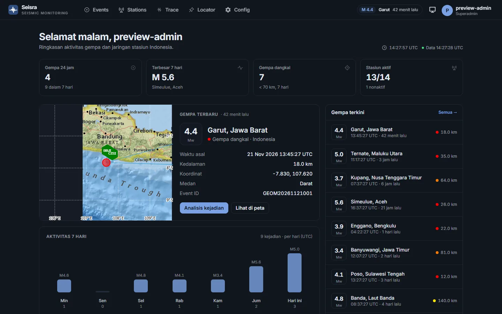
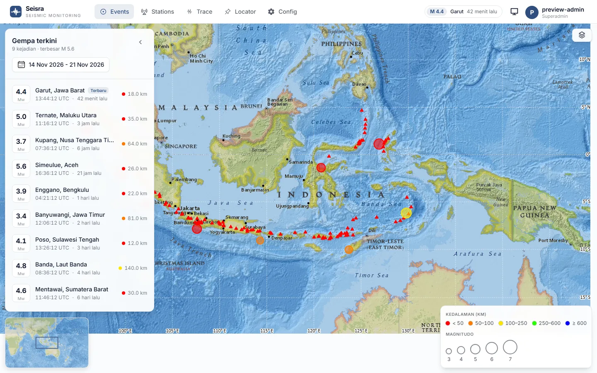
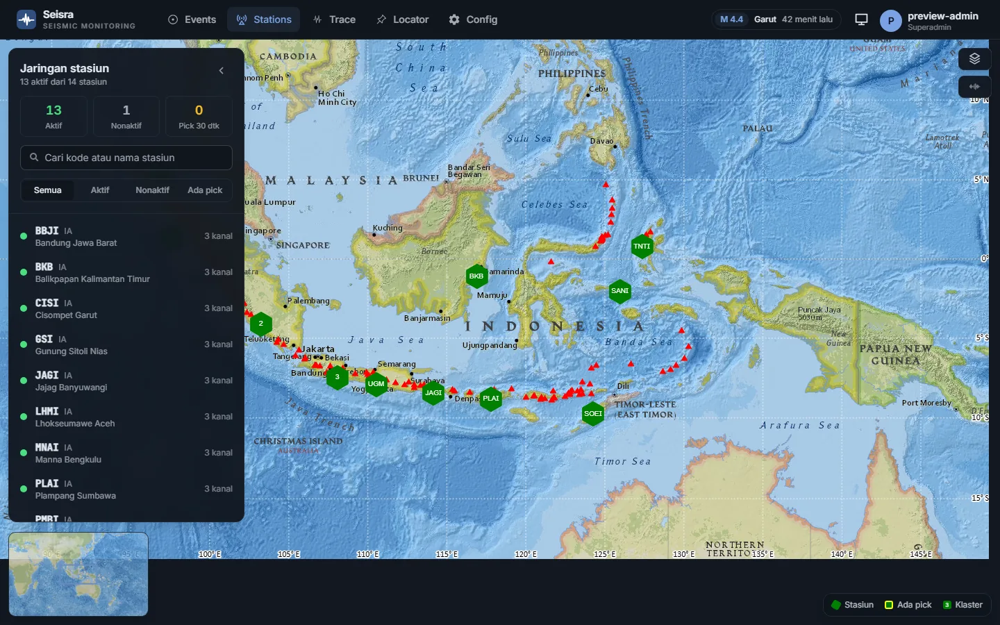
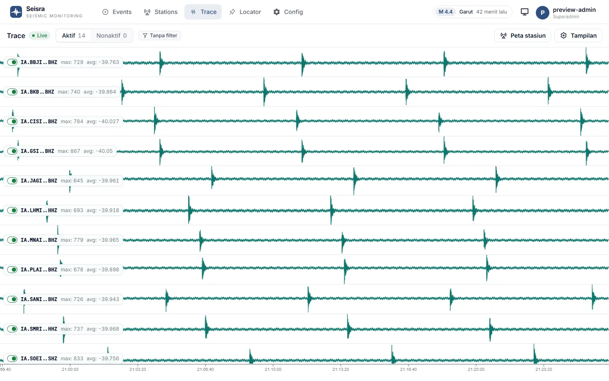
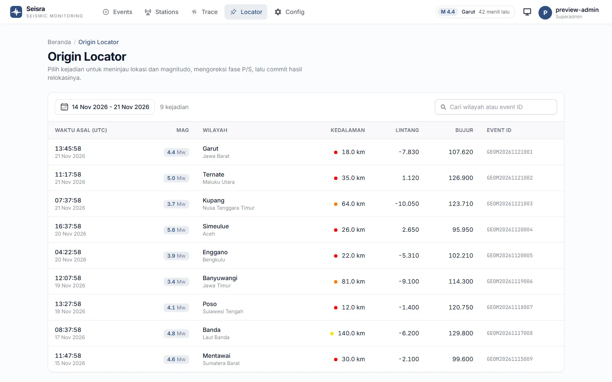
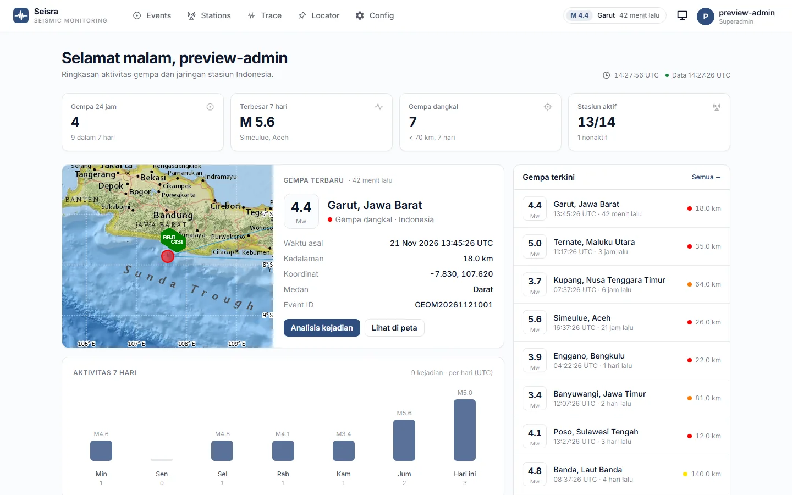
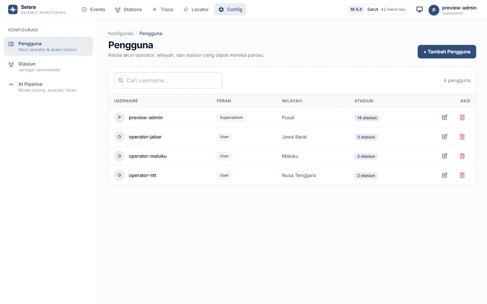

# Seisra

Seisra is an earthquake monitoring system for Indonesia.

Seisra streams waveforms from seismic stations (SeedLink). AI models pick P-wave
arrivals, associate them into events, and estimate location and magnitude. Operators
follow all of it live in a web dashboard.



<table>
  <tr>
    <td width="50%"><br><b>Events</b>: recent earthquakes on the map, by depth and magnitude</td>
    <td width="50%"><br><b>Stations</b>: network status, recent picks, waveforms per station</td>
  </tr>
  <tr>
    <td><br><b>Trace</b>: live waveforms from every active station</td>
    <td><br><b>Origin Locator</b>: review location and magnitude, correct P/S picks</td>
  </tr>
  <tr>
    <td><br><b>Light theme</b>: follows the system setting, or toggle it</td>
    <td><br><b>Config</b>: operators, stations and the AI pipeline</td>
  </tr>
</table>

<sub>Screenshots use the built-in preview data (<code>npm run dev:preview</code>), not a live network.</sub>

## Layout

```
web/        Vue 3 dashboard (Vite, Tailwind/DaisyUI, OpenLayers)
services/   backend: api + websockets, seedlink ingest, archive, record stream, FDSN, public API, flusher
ai/         p-pick, phase-arrival, association, locmag (TensorFlow models included)
scripts/    prune.sh (retention) and Windows helpers for the campus backend
docs/       architecture and local development
compose.yaml   the whole system, one file
```

## Run everything

```bash
cp .env.example .env          # set JWT_SECRET_KEY and INITIAL_ADMIN_PASSWORD
docker compose --profile all up -d --build
```

Open <http://localhost:8080> and log in with the admin account from `.env`.

| Command | Starts |
| --- | --- |
| `docker compose up -d` | infra + backend + web (no AI, much lighter) |
| `docker compose --profile ai up -d` | the above + the AI pipeline |
| `docker compose --profile all up -d` | everything |

Only the web app (8080), the FDSN API (38002) and the public ingest API (38007) are
published. Everything else stays on the internal Docker network.

## Work on the UI only

```bash
cd web
npm ci
npm run dev:preview   # fixture data, no backend at all  → http://127.0.0.1:5174
npm run dev:local     # against `docker compose up`      → http://127.0.0.1:5173
```

See [docs/local-development.md](docs/local-development.md) for working against the
campus server, and [docs/architecture.md](docs/architecture.md) for how data flows.

## Retention

`scripts/prune.sh` deletes archived waveforms and raw picks older than
`ARCHIVE_RETENTION_DAYS` / `DB_PICKS_RETENTION_DAYS`. Run it daily from cron.
Container logs are capped automatically (3 × 50 MB per service).

## History

This repository started fresh from
[`ai-gempa-bmkg`](https://github.com/mohamadsolkhannawawi/ai-gempa-bmkg) at `e0fe809`
plus the UI redesign. Only the code the deployment actually runs was carried over.
Older experiments, other AI variants and the previous history remain in that repository.
